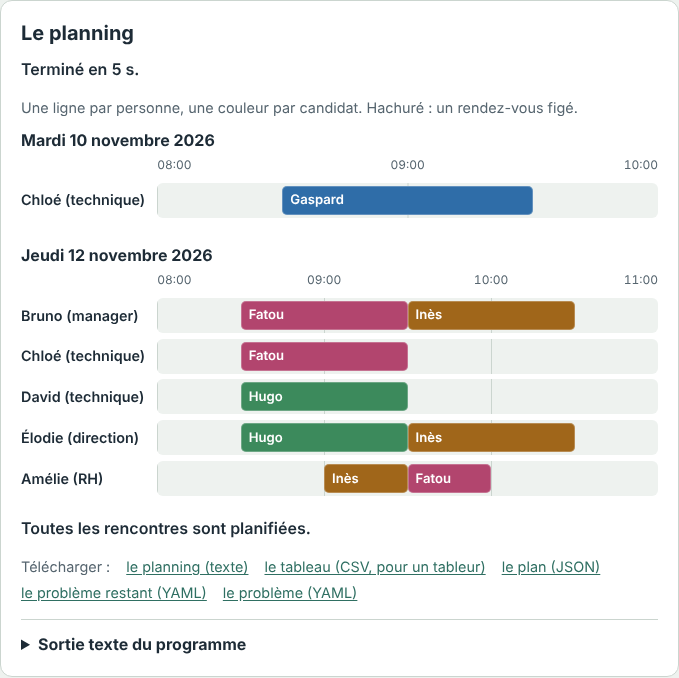
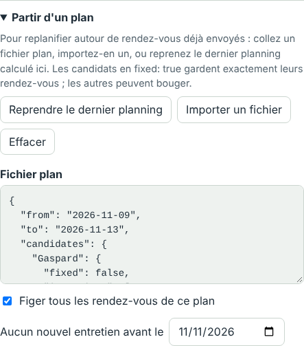

# Mode d'emploi

[English](GUIDE.md) · **Français**

Ce guide est pour vous si vous organisez des rendez-vous : une journée de
recrutement, des entretiens sur une semaine, un jury, des tournages… Vous
connaissez les disponibilités de chacun ; le programme trouve qui rencontre
qui, et quand. Pas besoin de
savoir programmer : tout se fait dans la
[démo en ligne](https://frederickfrance.github.io/igiveyouarendezvous/), dans
votre navigateur. Rien de ce que vous tapez n'est envoyé : le calcul se fait
sur votre ordinateur.

1. [Essayer en deux minutes](#1-essayer-en-deux-minutes)
2. [Décrire votre cas](#2-décrire-votre-cas)
3. [Lire le résultat](#3-lire-le-résultat)
4. [Envoyer les rendez-vous](#4-envoyer-les-rendez-vous)
5. [Quand quelque chose change](#5-quand-quelque-chose-change)
6. [Les pièges courants](#6-les-pièges-courants)
7. [Demander de l'aide](#7-demander-de-laide)

## 1. Essayer en deux minutes

1. Ouvrez la [démo](https://frederickfrance.github.io/igiveyouarendezvous/) ;
   en haut à droite, choisissez **Français**.
2. Sous **Exemples**, cliquez sur **Une semaine d'entretiens**.
3. Cliquez sur **Planifier**. Quelques secondes plus tard, le planning
   apparaît à droite : une ligne par personne, une couleur par candidat.

Le fichier à gauche est commenté : chaque ligne qui commence par `#`
explique la règle du dessous. Modifiez une disponibilité, planifiez de
nouveau, et regardez ce qui change.

## 2. Décrire votre cas

Le programme lit un **fichier problème** : qui doit rencontrer qui, et quand
chacun est libre. Deux façons de l'écrire, sans rien connaître au format.

### Avec un assistant IA (le plus simple)

1. Ouvrez la [consigne](prompt/fr.md) et copiez tout ce qui suit le trait.
2. Collez-la dans un assistant (Claude, ChatGPT, Mistral…) et écrivez vos
   règles à la fin, en français courant : « Trois recruteurs, Anne, Bruno et
   Chloé. Douze candidats. Du 16 au 20 novembre, de 9 h à 17 h, pause de
   12 h à 13 h 30. Chaque candidat voit Anne, puis Bruno. Chloé n'est là que
   le mardi. »
3. L'assistant vous pose des questions s'il manque quelque chose, puis donne
   le fichier, commenté règle par règle, et la liste de ce qu'il a supposé :
   lisez-la, c'est là que se cachent les malentendus.
4. Collez le fichier dans la démo, à la place de l'exemple, et planifiez. En
   cas d'erreur, recopiez le message à l'assistant : il corrige le fichier.

**Données personnelles.** Ce que vous tapez dans un assistant part chez son
fournisseur. Donnez-lui des noms de remplacement (`Candidat 1`, des
initiales) et remettez les vrais noms dans la démo ensuite : elle, n'envoie
rien.

### En partant d'un exemple

Prenez l'exemple le plus proche de votre cas, puis changez les noms, les
dates et les horaires :

| Votre cas | L'exemple |
|---|---|
| Une journée, chaque candidat voit un ou deux recruteurs | Une journée d'entretiens |
| Une semaine, des disponibilités par date, des priorités | Une semaine d'entretiens |
| Un jury : ses membres reçoivent ensemble | Une commission de recrutement |
| Des enregistrements avec des invités difficiles à réunir | Les enregistrements d'une émission |
| Des tournages dans plusieurs villes, avec les trajets | Une tournée de tournages dans cinq villes |
| Un colloque, des parties de jeu | Un colloque ; Des parties de jeu de rôle |

Trois règles d'écriture : gardez les espaces en début de ligne (deux de plus
pour ce qui appartient à la ligne du dessus) ; écrivez chaque nom de la même
façon partout ; écrivez les heures `09:00` et les dates `2026-11-16`.

### Les mots du fichier

Le fichier parle de « recruteurs » et de « candidats », mais il sert à bien
d'autres choses :

| Mot | Ce que c'est | Ailleurs |
|---|---|---|
| `recruiters` | les personnes qui reçoivent, une à la fois | jurés, invités d'une émission, l'équipe d'un tournage |
| `candidates` | ce qu'il faut planifier | un épisode, une partie, un tournage |
| `meet` | qui le candidat doit voir, éventuellement dans un ordre | |
| `availability` | quand une personne est libre ; sans elle, les horaires de `day` | |
| `duration` | la durée d'un entretien | |
| `together: true` | une réunion : tout le monde à la fois | un enregistrement, un tournage |
| `place`, `travel` | le lieu d'un candidat, et les trajets entre les lieux | les villes d'une tournée |

Toutes les clés sont dans le [README](README.fr.md#le-fichier-problème).

## 3. Lire le résultat

- **Le statut**, sous « Le planning » : la recherche s'arrête quand elle ne
  s'améliore plus, ou au bout du temps choisi dans **Chercher au plus**. Pour
  un gros cas, donnez-lui plus de temps.
- **Les notes**, en anglais au-dessus du planning : une personne sans
  disponibilité, un lieu qu'aucun trajet ne nomme… Ce ne sont pas des
  erreurs, mais vérifiez qu'elles sont voulues.
- **Le planning** : une ligne par personne, une couleur par candidat, jour
  par jour. Hachuré : un rendez-vous figé (voir plus bas).
- **Sous le planning** : « Toutes les rencontres sont planifiées », ou
  « À planifier plus tard », les candidats qui ne tiennent pas dans la
  période, pour la suivante. « Impossible » signale quelqu'un qui n'est
  jamais disponible, ou deux personnes jamais libres ensemble assez
  longtemps : c'est le fichier qu'il faut revoir, pas la recherche.
- **Une erreur** dit ce qui ne va pas, et la ligne en cause est sélectionnée
  dans l'éditeur.

Ce que le programme cherche, dans l'ordre : le plus de candidats qui voient
tous leurs recruteurs, les prioritaires d'abord, puis les plus urgents ; puis
le plus de rencontres ; puis le moins de journées et de demi-journées de
présence pour les recruteurs, et des journées compactes. Pour un autre ordre
(finir tôt, attendre le moins possible…), voyez les
[objectifs](README.fr.md#objectifs).

## 4. Envoyer les rendez-vous

Sous le planning, **Télécharger** propose :

- **le tableau (CSV, pour un tableur)** : une ligne par entretien, pour Excel
  ou un publipostage des convocations dans Word ou LibreOffice ;
- **le plan (JSON)** : gardez-le, il sert à replanifier (section suivante) ;
- **le problème restant (YAML)** : les candidats qui n'ont pas trouvé de
  place, pour la période suivante.

## 5. Quand quelque chose change

Un candidat se désiste, une recruteuse tombe malade, de nouveaux candidats
arrivent… sans tout déplacer :

1. Modifiez le fichier problème : retirez, ajoutez, changez une
   disponibilité.
2. Ouvrez **Partir d'un plan**, puis **Reprendre le dernier planning** si la
   page est restée ouverte, ou **Importer un fichier** avec le plan
   téléchargé.
3. Les rendez-vous déjà annoncés ne doivent plus bouger : cochez **Figer
   tous les rendez-vous de ce plan**. (Pour n'en figer que certains, mettez
   `fixed: true` sous ces candidats dans le plan, `false` sous les autres.)
4. Au milieu de la période, mettez demain dans **Aucun nouvel entretien
   avant le** : rien de nouveau n'est placé avant.
5. Planifiez. Si un rendez-vous figé ne tient plus, parce que la personne
   n'est plus disponible par exemple, la démo le signale en tête de la
   sortie texte, et ce candidat est replanifié.

## 6. Les pièges courants

- **Les horaires par défaut** ne sont que `08:00-12:00` : écrivez toujours
  `day`, par exemple `day: 09:00-17:00`.
- **Quelqu'un d'absent certains jours** : listez par date tous ses jours de
  présence. Une personne dont les disponibilités sont données par date est
  absente les autres dates ; ne lister que ses jours d'absence la rendrait
  absente toute la période.
- **Les écarts** (`min-gap`, `max-gap`) valent entre deux entretiens
  consécutifs quelconques d'un candidat. Par défaut, ses entretiens se
  suivent, le même jour.
- **Un nom écrit autrement** dans `meet` que sous `recruiters` est une
  erreur : le programme le dit, avec la ligne.
- **Entre accolades**, mettez les plages horaires entre guillemets :
  `{availability: "09:00-12:00, 14:00-16:00"}`.
- **Personne ne tient** : une règle est sans doute trop stricte. Relâchez-la
  (un écart, une disponibilité, une durée) et planifiez de nouveau.

## 7. Demander de l'aide

Sous **Un souci ? Une idée ?**, **Copier le lien de mon cas** fabrique un
lien qui contient tout votre problème : il ouvre la démo avec votre fichier.
Le problème est après le `#` du lien, que le navigateur n'envoie jamais au
serveur. Envoyez-le par un message sur
[LinkedIn](https://www.linkedin.com/in/frederic-sauvage-rueangpanichpiban),
ou dans une [issue](https://github.com/FrederickFrance/igiveyouarendezvous/issues/new/choose)
si vous avez un compte GitHub. Une issue est publique : utilisez des noms
inventés.

Pour un usage régulier, le programme téléchargé fait la même chose, plus
vite et sans limite de temps : voyez
[Premier planning, pas à pas](README.fr.md#premier-planning-pas-à-pas).
