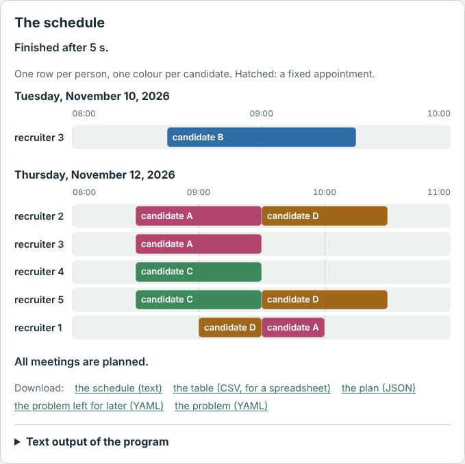
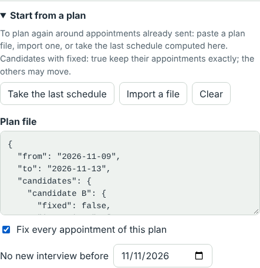

# User guide

**English** · [Français](GUIDE.fr.md)

This guide is for you if you organise appointments: a recruitment day,
interviews over a week, a jury, shoots… You know when
everybody is free; the program finds who meets whom, and when. No
programming needed: everything happens in the
[online demo](https://frederickfrance.github.io/igiveyouarendezvous/), in
your browser. Nothing you type is sent anywhere: the computation runs on
your computer.

1. [Try it in two minutes](#1-try-it-in-two-minutes)
2. [Describe your case](#2-describe-your-case)
3. [Read the result](#3-read-the-result)
4. [Send the appointments](#4-send-the-appointments)
5. [When something changes](#5-when-something-changes)
6. [Common traps](#6-common-traps)
7. [Ask for help](#7-ask-for-help)

## 1. Try it in two minutes

1. Open the [demo](https://frederickfrance.github.io/igiveyouarendezvous/).
2. Under **Examples**, click **A week of interviews**.
3. Click **Plan**. A few seconds later, the schedule appears on the right:
   one row per person, one colour per candidate.

The file on the left has comments: each line that starts with `#` explains
the rule below it. Change an availability, plan again, and see what
changes.

## 2. Describe your case

The program reads a **problem file**: who must meet whom, and when everybody
is free. Two ways to write it, without knowing the format.

### With an AI assistant (the simplest)

1. Open the [prompt](prompt/en.md) and copy everything below the line.
2. Paste it into an assistant (Claude, ChatGPT, Mistral…) and write your
   rules at the end, in plain words: "Three recruiters, Ann, Bob and Chloe.
   Twelve candidates. From 16 to 20 November, 9 am to 5 pm, lunch from
   12:00 to 13:30. Each candidate meets Ann, then Bob. Chloe is only there
   on Tuesday."
3. The assistant asks you questions if something is missing, then gives the
   file, commented rule by rule, and the list of what it assumed: read it,
   that is where misunderstandings hide.
4. Paste the file into the demo, in place of the example, and plan. On an
   error, give the message back to the assistant: it corrects the file.

**Personal data.** Whatever you type into an assistant goes to its
provider. Give it placeholders (`Candidate 1`, initials) and put the real
names back in the demo afterwards: the demo sends nothing.

### From an example

Take the example closest to your case, then change the names, dates and
hours:

| Your case | The example |
|---|---|
| One day, each candidate meets one or two recruiters | A day of interviews |
| A week, availabilities by date, priorities | A week of interviews |
| A jury: its members interview together | A selection panel |
| Recordings with guests who are hard to gather | Recordings of a show |
| Shoots in several cities, with the journeys | A tour of shoots in five cities |
| A colloquium, games | A colloquium; Role-playing games |

Three writing rules: keep the spaces at the start of the lines (two more
for what belongs to the line above); write each name the same way
everywhere; write times `09:00` and dates `2026-11-16`.

### The words of the file

The file speaks of "recruiters" and "candidates", but it serves many other
purposes:

| Word | What it is | Elsewhere |
|---|---|---|
| `recruiters` | the people who receive, one at a time | jury members, guests of a show, the crew of a shoot |
| `candidates` | what has to be planned | an episode, a game, a shoot |
| `meet` | whom the candidate must meet, one interview each, possibly in an order | |
| `meetings` | meetings with several people at once, as given; somebody may come back | the scenes of a shoot, a candidate who meets the lead again |
| `availability` | when a person is free; without it, the hours of `day` | |
| `duration` | the length of an interview | |
| `together: true` | a meeting: everybody of `meet` at once | a recording |
| `place`, `travel` | the place of a candidate, and the journeys between places | the cities of a tour |

Every key is in the [README](README.md#the-problem-file).

## 3. Read the result

- **The status**, under "The schedule": the search stops when it no longer
  improves, or after the time chosen in **Search for at most**. For a big
  case, give it more time.
- **The notes**, above the schedule: a person without availability, a place
  that no journey names… They are not errors, but check that they are
  intended.
- **The schedule**: one row per person, one colour per candidate, day by
  day. Hatched: a fixed appointment (see below).
- **Under the schedule**: "All meetings are planned", or "To plan later",
  the candidates who do not fit in the period, for the next one.
  "Impossible" points at somebody never available, or two people never free
  together long enough: the file needs a look, not the search.
- **An error** says what is wrong, and the line at fault is selected in the
  editor.

What the program looks for, in this order: the most candidates who meet
all their recruiters, the priority ones first, then the most urgent; then
the most meetings; then the fewest days and half-days of presence for the
recruiters, and compact days. For another order (finish early, wait as
little as possible…), see the [objectives](README.md#objectives).

## 4. Send the appointments

Under the schedule, **Download** offers:

- **the table (CSV, for a spreadsheet)**: one row per interview, for Excel
  or a mail merge of the invitations in Word or LibreOffice;
- **the plan (JSON)**: keep it, it serves to plan again (next section);
- **the problem left for later (YAML)**: the candidates who found no place,
  for the next period.

## 5. When something changes

A candidate withdraws, a recruiter falls ill, new candidates come… without
moving everything:

1. Change the problem file: remove, add, change an availability.
2. Open **Start from a plan**, then **Take the last schedule** if the page
   stayed open, or **Import a file** with the plan downloaded.
3. The appointments already announced must not move: tick **Fix every
   appointment of this plan**. (To fix only some, write `fixed: true` under
   these candidates in the plan, `false` under the others.)
4. In the middle of the period, put tomorrow in **No new interview
   before**: nothing new is placed before.
5. Plan. If a fixed appointment no longer holds, because the person is no
   longer available for instance, the demo says so at the top of the text
   output, and that candidate is planned again.

## 6. Common traps

- **The default hours** are only `08:00-12:00`: always write `day`, such as
  `day: 09:00-17:00`.
- **Somebody absent on some days**: list by date every day they are
  present. A person whose availability is given by date is absent on the
  other dates; listing only the days of absence would make them absent for
  the whole period.
- **The gaps** (`min-gap`, `max-gap`) apply between any two consecutive
  interviews of a candidate. By default, their interviews follow each
  other, the same day.
- **A name written differently** in `meet` or `meetings` than under
  `recruiters` is an error: the program says so, with the line.
- **Inside braces**, quote the time spans:
  `{availability: "09:00-12:00, 14:00-16:00"}`.
- **Nobody fits**: a rule is probably too strict. Relax it (a gap, an
  availability, a length) and plan again.

## 7. Ask for help

Under **A problem, an idea?**, **Copy the link of my case** makes a link
that holds your whole problem: it opens the demo with your file. The
problem is after the `#` of the link, which the browser never sends to the
server. Send it in a message on
[LinkedIn](https://www.linkedin.com/in/frederic-sauvage-rueangpanichpiban),
or in an [issue](https://github.com/FrederickFrance/igiveyouarendezvous/issues/new/choose)
if you have a GitHub account. An issue is public: use made-up names.

For regular use, the downloaded program does the same, faster and without
a time limit: see
[Your first schedule, step by step](README.md#your-first-schedule-step-by-step).
